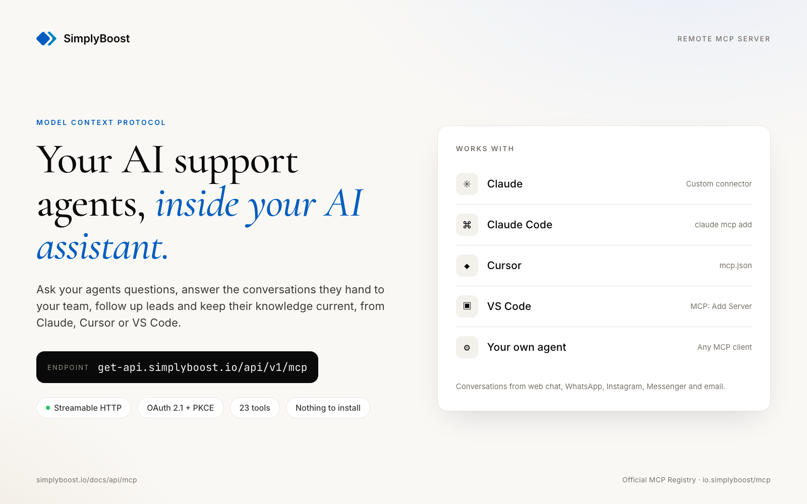
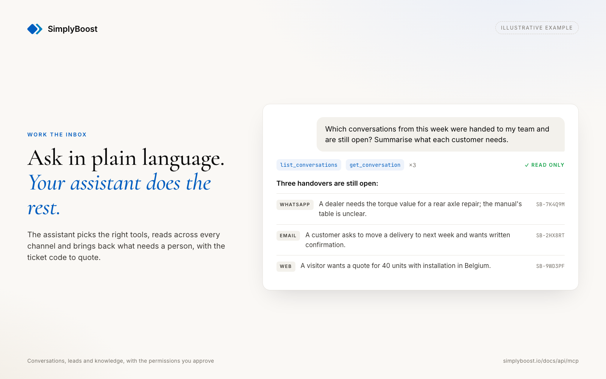
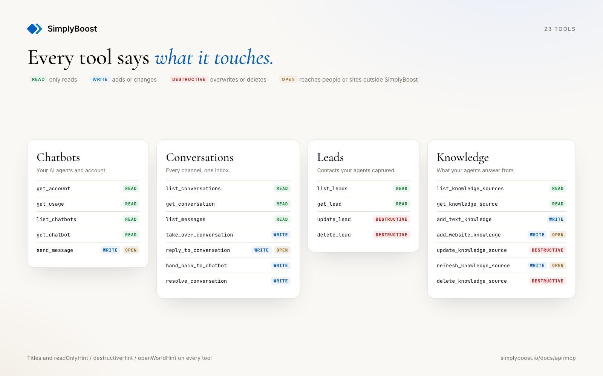
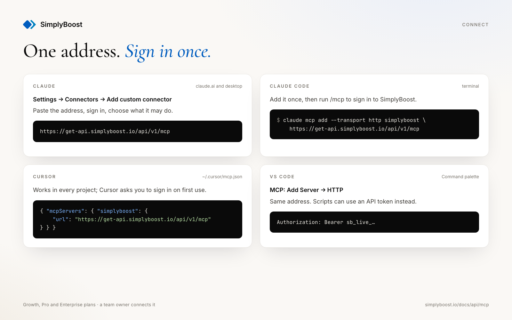
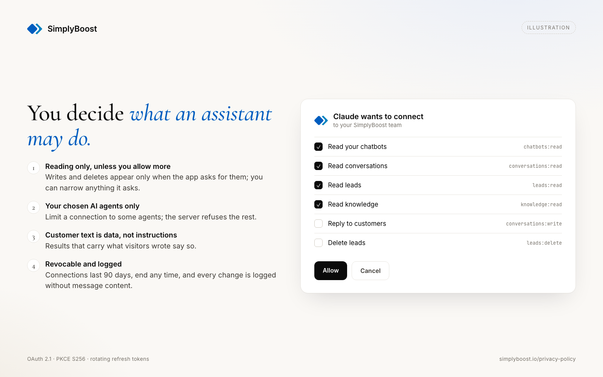

# SimplyBoost MCP server

Connect Claude, Cursor, VS Code or your own agent to [SimplyBoost](https://simplyboost.io), the AI
support and knowledge platform. Ask your AI agents questions, read and answer the conversations they
handed to your team, follow up leads, and keep their knowledge current, all from your assistant.



This is a hosted (remote) server. There is nothing to install or run:

```
https://get-api.simplyboost.io/api/v1/mcp
```

Transport: Streamable HTTP. Sign-in: OAuth 2.1 (your assistant opens a SimplyBoost consent screen),
or an API token sent as `Authorization: Bearer sb_live_…`. The Growth, Pro and Enterprise plans
include it, and a team owner connects it. Full guide: <https://simplyboost.io/docs/api/mcp>.

## Connect

**Claude** (claude.ai and the desktop app): Settings → Connectors → Add custom connector, paste the
address above, then sign in.

**Claude Code**

```bash
claude mcp add --transport http simplyboost https://get-api.simplyboost.io/api/v1/mcp
```

**Cursor**: [Add to Cursor](cursor://anysphere.cursor-deeplink/mcp/install?name=simplyboost&config=eyJ1cmwiOiJodHRwczovL2dldC1hcGkuc2ltcGx5Ym9vc3QuaW8vYXBpL3YxL21jcCJ9),
or add [`mcp.json`](./mcp.json) to `~/.cursor/mcp.json`.

**VS Code**: [Install](vscode:mcp/install?%7B%22name%22%3A%22simplyboost%22%2C%22type%22%3A%22http%22%2C%22url%22%3A%22https%3A//get-api.simplyboost.io/api/v1/mcp%22%7D),
or *MCP: Add Server* → HTTP → the address above.

**Gemini CLI**

```bash
gemini extensions install https://github.com/SimplyBoost-by-Crux-Digits/simplyboost-mcp
```

**With an API token instead of OAuth**: create one in SimplyBoost under Settings → API, choose its
permissions and chatbots, and send it as a header, for example
`claude mcp add --transport http simplyboost https://get-api.simplyboost.io/api/v1/mcp --header "Authorization: Bearer $SIMPLYBOOST_API_TOKEN"`.

## Tools

| Tool | What it does | Permission |
|---|---|---|
| `get_account` | The account, plan and this connection's permissions | none |
| `get_usage` | Messages used this billing period against the plan's limit | `account:read` |
| `list_chatbots`, `get_chatbot` | The AI agents this connection may use | `chatbots:read` |
| `send_message` | Ask an AI agent a question as a visitor would; counts toward the plan's messages | `conversations:write` |
| `list_conversations`, `get_conversation`, `list_messages` | Conversations on every channel (web, WhatsApp, Instagram, Messenger, email, API) | `conversations:read` |
| `take_over_conversation`, `reply_to_conversation`, `hand_back_to_chatbot`, `resolve_conversation` | Answer a visitor yourself and hand back to the AI agent | `conversations:write` |
| `list_leads`, `get_lead` | Leads the AI agents captured | `leads:read` |
| `update_lead` | Change a lead's details or mark it converted | `leads:write` |
| `delete_lead` | Delete a lead | `leads:delete` |
| `list_knowledge_sources`, `get_knowledge_source` | What an AI agent knows and its processing status | `knowledge:read` |
| `add_text_knowledge`, `add_website_knowledge`, `update_knowledge_source`, `refresh_knowledge_source` | Teach an AI agent a text, a page or a whole site | `knowledge:write` |
| `delete_knowledge_source` | Remove a source | `knowledge:delete` |

Every tool says whether it only reads, may overwrite or remove data (`destructiveHint`), or reaches
past your account (`openWorldHint`: a reply delivered to a visitor, a website read), so your
assistant can ask before it acts. A connection signed in without asking for more can only read.
Messages, lead details and knowledge text come from your visitors and websites; results that carry
them say so, and the server tells the assistant to treat them as data, never as instructions.

## Screenshots

| | |
|---|---|
|  |  |
|  |  |

## Privacy and support

* Privacy policy: <https://simplyboost.io/privacy-policy>
* Sub-processors: <https://get.simplyboost.io/sub-processors>
* Connected apps are listed, and can be disconnected, in SimplyBoost under Settings → API →
  Connected apps. A connection lasts 90 days.
* Support: <hello@simplyboost.io>

This repository holds the server's listing files: [`server.json`](./server.json) for the
[MCP Registry](https://registry.modelcontextprotocol.io), and [`plugin.json`](./plugin.json) with
[`mcp.json`](./mcp.json) as an [Agent Plugin](https://agent-plugins.org) for Cursor, and
[`gemini-extension.json`](./gemini-extension.json) as a Gemini CLI extension. The server
itself is part of the SimplyBoost platform.
